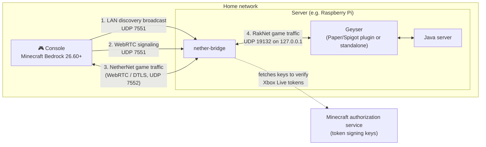
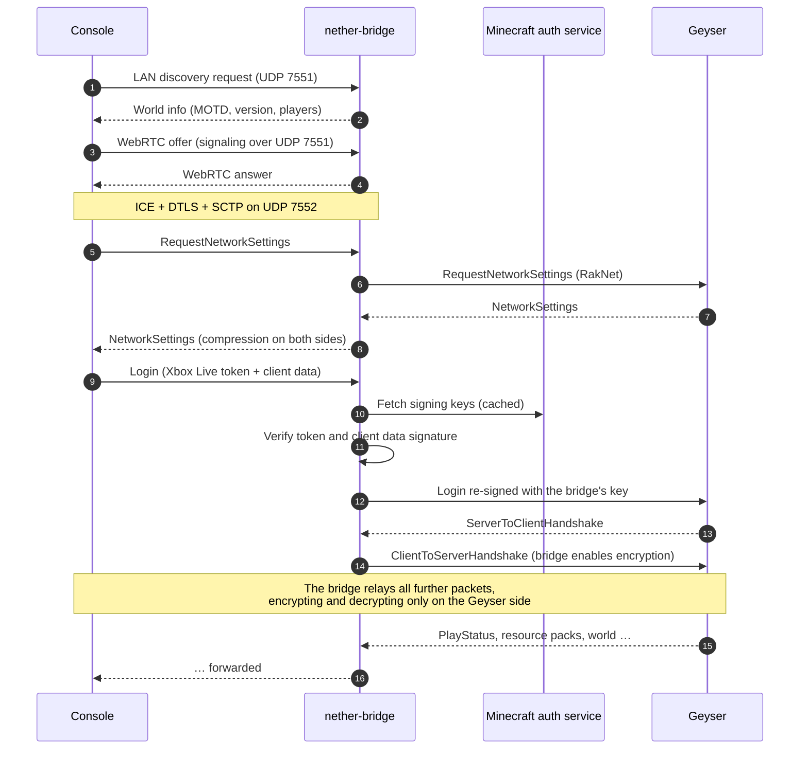

# nether-bridge

A small bridge that makes a [Geyser](https://geysermc.org) server show up again in the **Friends → LAN Games**
tab of Minecraft: Bedrock Edition **26.60+** on consoles (Xbox, PlayStation, Switch) and other clients,
and lets players join it from there.

> [!WARNING]
> **Temporary workaround for home networks only. Do not use it on public servers.**
>
> nether-bridge requires `validate-bedrock-login: false` in Geyser's configuration. With that setting,
> Geyser no longer checks Xbox Live logins itself and trusts whatever login it receives. nether-bridge
> verifies every console login before passing it on, but **anyone who can reach Geyser's Bedrock port
> directly can join under any name, including an operator's**. Floodgate skin uploading and account
> linking stop working as well.
>
> Use it only when Geyser's Bedrock port is reachable from your local network alone (no port forwarding
> on the router), and switch back to `validate-bedrock-login: true` once Geyser supports LAN discovery
> itself.

## The problem

Up to Bedrock 26.50, consoles found LAN worlds by broadcasting RakNet pings on UDP port 19132, and Geyser
answered them, so a Geyser server on the same network appeared in the LAN tab. This was the usual way
to get a console onto a Geyser server without tricks, as consoles cannot add custom servers.

Since **26.60**, the game discovers LAN worlds with **NetherNet** broadcasts on **UDP port 7551** and joins
them over WebRTC, using the same port for signaling. Geyser supports NetherNet only through HTTP
signaling (the Servers tab) and does not listen on port 7551, so the server disappeared from the LAN tab.

## How it works

nether-bridge runs next to Geyser and stands in for it on the LAN:



1. **Discovery.** It answers the LAN broadcasts on port 7551 with Geyser's MOTD, version and player count,
   which it reads by pinging Geyser every few seconds.
2. **Signaling and WebRTC.** It accepts the console's NetherNet (WebRTC) connection, using port 7551 for
   signaling and one fixed UDP port (7552 by default) for the data.
3. **Login.** It opens a RakNet connection to Geyser for each player and logs in on the player's behalf
   (see below).
4. **Relay.** From then on it forwards the game packets in both directions without decoding them.

### Why the bridge has to handle the login

NetherNet relies on DTLS for encryption, so consoles do not use Minecraft's own encryption on it. Geyser
does use Minecraft's encryption on RakNet, with a key derived from the player's login key, and only the
console holds that key. A transparent relay therefore cannot work: the console ignores Geyser's encryption
handshake. Connecting to Geyser over NetherNet instead does not help either, as Geyser requires the
NetherNet identity of the connection to match the login, which a proxy cannot provide.

So the bridge completes the login itself:



The bridge checks that the console's multiplayer token was issued by Minecraft's authorization service
and that the client data is signed with the key in that token. It then sends Geyser the same player
data (name, XUID, skin, device info) signed with its own key, as a self-signed login. Geyser derives the
player's UUID from the XUID exactly as it does for a direct connection, so existing player data is kept.
Geyser accepts a self-signed login only with `validate-bedrock-login: false`, hence the warning above.

## Requirements

- A Geyser build with Bedrock 26.60 support and the **RakNet transport enabled** (`transport: raknet` or
  `both`).
- A 64-bit Linux host on the same network (subnet) as the console, usually the machine that runs Geyser.
  The steps below use a Raspberry Pi 5 with Raspberry Pi OS (64-bit), but any Linux works.
- No other program on the host using UDP port 7551 or 7552.
- Internet access on the host, to fetch the authorization service's keys.
- Consoles signed in to Xbox Live / Microsoft accounts.
- [Go](https://go.dev/dl/) 1.27 or newer on the machine you build on.

## Step-by-step setup

### 1. Build the binary

Clone the repository and build it on any machine with Go. Cross-compiling for the Pi takes one command:

```sh
git clone https://github.com/martinorgla/go-nether-raknet.git
cd go-nether-raknet

make pi        # dist/nether-bridge-linux-arm64 (Raspberry Pi 3/4/5 with a 64-bit OS)
# or
make build     # dist/nether-bridge for the machine you are on
```

Without `make`:

```sh
CGO_ENABLED=0 GOOS=linux GOARCH=arm64 go build -trimpath -ldflags="-s -w" -o dist/nether-bridge-linux-arm64 .
```

Use `GOARCH=amd64` for a regular 64-bit PC.

### 2. Configure Geyser

Edit Geyser's `config.yml` (for the Spigot/Paper plugin it is `plugins/Geyser-Spigot/config.yml`):

```yaml
bedrock:
  address: 0.0.0.0
  port: 19132
  # RakNet must stay enabled on this port. "nethernet" alone does NOT work with the bridge.
  transport: both

advanced:
  bedrock:
    # Required by nether-bridge. See the warning at the top. Not for public servers!
    validate-bedrock-login: false
```

Restart the server and check Geyser's log for errors.

### 3. Keep Geyser's Bedrock port private

Make sure that only your local network can reach Geyser's Bedrock port:

- **Remove any port forwarding** for 19132 (UDP or TCP) on your router.
- If the host runs a firewall, limit the port to your LAN. With `ufw`, replace `192.168.0.0/24` with
  your network:

  ```sh
  sudo ufw delete allow 19132/udp          # if it was open to everyone
  sudo ufw allow from 192.168.0.0/24 to any port 19132 proto udp
  ```

### 4. Open the bridge's ports in the firewall

Skip this step if the host has no firewall. With `ufw`:

```sh
sudo ufw allow from 192.168.0.0/24 to any port 7551 proto udp comment 'Bedrock LAN discovery'
sudo ufw allow from 192.168.0.0/24 to any port 7552 proto udp comment 'nether-bridge WebRTC'
```

### 5. Try it out

Copy the binary to the host and run it by hand first:

```sh
scp dist/nether-bridge-linux-arm64 pi@<host-ip>:
ssh pi@<host-ip>
chmod +x nether-bridge-linux-arm64
./nether-bridge-linux-arm64 -debug
```

You should see `nether-bridge started` and no `cannot ping Geyser` warning. On the console, open
**Play → Friends**: the server should be listed under **LAN Games**. Join it. The log should show:

```
level=INFO msg="client connected over LAN" ...
level=INFO msg="player logged in" name=<gamertag> xuid=<xuid>
level=INFO msg="logged in to Geyser, relaying"
```

The console may ask once whether to trust the server. That is expected. Stop the bridge with `Ctrl+C`.

### 6. Install it as a service

```sh
sudo install -m 755 nether-bridge-linux-arm64 /usr/local/bin/nether-bridge
sudo cp deploy/nether-bridge.service /etc/systemd/system/   # from the repository
sudo systemctl daemon-reload
sudo systemctl enable --now nether-bridge
journalctl -u nether-bridge -f
```

The service runs as an unprivileged dynamic user and keeps its key in `/var/lib/nether-bridge`.

## Command-line flags

| Flag | Default | Description |
|---|---|---|
| `-geyser` | `127.0.0.1:19132` | UDP address of Geyser's RakNet listener |
| `-lan` | `0.0.0.0:7551` | UDP address for LAN discovery and signaling. Consoles always use port 7551. |
| `-ice-port` | `7552` | UDP port shared by all WebRTC connections. Allow it in the firewall. `0` picks random ports. |
| `-identity` | `nether-bridge-identity.pem` | Key file of the bridge, created on first start. Keeping it stops consoles from asking to trust the server again. |
| `-name` | `Geyser` | World name shown until Geyser answers the first ping |
| `-status-interval` | `5s` | How often to refresh the MOTD and player count from Geyser |
| `-debug` | `false` | Log every signaling message and more. For WebRTC/ICE details also set the environment variable `PION_LOG_DEBUG=ice`. |
| `-trickle` | `false` | Send ICE candidates in separate signals instead of inline in the answer. Consoles did not connect with it in testing. |
| `-identity-assertion` | `false` | Include a server identity assertion in answers. Consoles did not connect with it in testing. |

Each flag must be followed by its value, e.g. `-debug -geyser 127.0.0.1:19132`, not `-geyser -debug ...`.

## Troubleshooting

| Symptom / log message | Likely cause |
|---|---|
| The server does not appear in the LAN tab | The console and host are on different subnets, the router isolates Wi-Fi clients (guest network, "AP/client isolation"), or UDP 7551 is blocked by the host's firewall. |
| `cannot ping Geyser` | Geyser is not running or RakNet is disabled. Check `transport` and `port` in Geyser's config. |
| `start ICE: context deadline exceeded` | The console cannot reach UDP 7552 on the host. Check the firewall (step 4). |
| `verify multiplayer token` | The login could not be verified: the host has no internet access, the clock is wrong, or the console is not signed in to Xbox Live. |
| Geyser logs `invalid_xbox_account` or `Unable to complete login` | `validate-bedrock-login` is still `true`. |
| `unexpected argument` at startup | A flag is missing its value (see above). |

To diagnose connection problems, run with `-debug` and `PION_LOG_DEBUG=ice`, and capture the traffic:

```sh
sudo tcpdump -ni any 'udp and host <console-ip> and not port 7551'
```

## Limitations

- **Not for public servers**, see the warning at the top.
- Floodgate skin uploading and account linking do not work with `validate-bedrock-login: false`.
- Geyser sees every bridged player as connecting from `127.0.0.1`.
- Transfer packets (moving players to another server) are not supported.
- The login handling depends on the login format of the current Minecraft version. A future update may
  require updating the [gophertunnel](https://github.com/Sandertv/gophertunnel) dependency and rebuilding.
- Only tested with an Xbox on Bedrock 26.60 and Geyser on Paper.

Once Geyser supports NetherNet LAN discovery itself, stop the bridge and set `validate-bedrock-login`
back to `true`.

## Development

```sh
go test -race ./...
```

The tests run the whole chain locally: a LAN client discovers and dials the bridge over NetherNet, and
logs in through it to a [gophertunnel](https://github.com/Sandertv/gophertunnel) Bedrock server that
stands in for Geyser. They also check that logins with unverifiable tokens are rejected.

| File | Purpose |
|---|---|
| `main.go` | Flags, LAN discovery and NetherNet listener setup |
| `signaling.go` | Adjusts WebRTC answers to what consoles accept, logs signaling |
| `bridge.go` | LAN world advertisement and per-connection handling |
| `session.go` | Login sequence, encryption handshake with Geyser, packet relay |
| `login.go` | Xbox Live token verification and login re-signing |
| `identity.go` | Persistent key of the bridge |

Built on [go-nethernet](https://github.com/df-mc/go-nethernet), [go-raknet](https://github.com/Sandertv/go-raknet),
[gophertunnel](https://github.com/Sandertv/gophertunnel) and [Pion WebRTC](https://github.com/pion/webrtc).

## License

[MIT](LICENSE)

## Disclaimer

Not affiliated with Mojang, Microsoft or GeyserMC. Use at your own risk.
